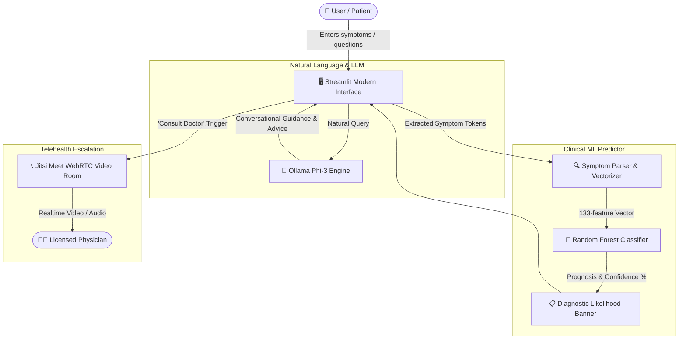

<div align="center">

# 🩺 WhiteHatters | AI Healthcare Assistant

### *Your Health, a Clearer Conversation — Think Clearly. Decide Confidently.*

[](https://www.python.org/)
[](https://streamlit.io/)
[](https://ollama.ai/)
[](https://scikit-learn.org/)
[](https://meet.jit.si/)
[](LICENSE)

<br/>

**WhiteHatters Healthcare Assistant** is an intelligent, privacy-first clinical triage and conversational companion. By fusing **Random Forest machine learning** on clinical datasets with the **Ollama Phi-3 local language model**, it enables users to analyze symptoms, discover potential conditions with statistical confidence, and instantly transition to **telehealth video consultations** with human doctors.

[Features](#-key-features) • [Architecture](#-architecture--workflow) • [Quickstart](#-quickstart--installation) • [Dataset & ML](#-machine-learning--dataset) • [Screenshots & UI](#-ui--design-system) • [Disclaimer](#-medical-disclaimer)

---

</div>

## 🌟 Key Features

<table>
  <tr>
    <td width="50%">
      <h3>🤖 Local LLM Conversational Triage</h3>
      <ul>
        <li>Powered by <b>Ollama (Phi-3)</b> for high-speed, local conversational AI.</li>
        <li>100% private: Medical conversations never leave your device.</li>
        <li>Context-aware chat memory with built-in connection error recovery.</li>
      </ul>
    </td>
    <td width="50%">
      <h3>📊 Multi-Condition ML Diagnostic Engine</h3>
      <ul>
        <li>Trained on <b>4,920 patient symptom records</b> across <b>133 symptoms</b>.</li>
        <li>Classifies across <b>41 unique medical prognoses</b> using <code>RandomForestClassifier</code>.</li>
        <li>Outputs probable condition alongside a percentage <b>Confidence Score</b>.</li>
      </ul>
    </td>
  </tr>
  <tr>
    <td width="50%">
      <h3>📞 Instant Telehealth Escalation</h3>
      <ul>
        <li>Bridge the gap between AI triage and accredited medical professionals.</li>
        <li>One-click encrypted video rooms powered by <b>Jitsi Meet</b> iframe.</li>
        <li>Zero plugins or registrations required for quick doctor consultation.</li>
      </ul>
    </td>
    <td width="50%">
      <h3>✨ Sleek, Modern Glassmorphism UI</h3>
      <ul>
        <li>Bespoke dark aesthetic with custom typography (<code>Inter</code>) and vibrant gradients.</li>
        <li>Fully responsive layout for desktop, tablet, and mobile browsers.</li>
        <li>Smooth micro-animations, accessible contrast ratios, and tactile input fields.</li>
      </ul>
    </td>
  </tr>
</table>

---

## 🏗️ Architecture & Workflow



---

## 🚀 Quickstart & Installation

Follow these steps to run WhiteHatters Healthcare Assistant locally on your machine:

### 1. Prerequisites
- **Python**: Version 3.10, 3.11, or 3.12 installed.
- **Ollama**: Installed from [ollama.com](https://ollama.com/).
- **Git**: Installed on your system.

### 2. Clone the Repository
```bash
git clone https://github.com/hackerjose25/chat_bot.git
cd chat_bot
```

### 3. Setup Virtual Environment
```bash
# Windows (PowerShell)
python -m venv .venv
.\.venv\Scripts\Activate.ps1

# Linux / macOS
python3 -m venv .venv
source .venv/bin/activate
```

### 4. Install Dependencies
```bash
pip install -r requirements.txt
```
*(Or install manually: `pip install streamlit pandas numpy scikit-learn ollama`)*

### 5. Pull & Start the Ollama LLM
Ensure Ollama is running, then pull the lightweight `phi3` model:
```bash
ollama pull phi3
```

### 6. Launch the Application
```bash
streamlit run chatbotapp.py
```
Your default browser will automatically open to `http://localhost:8501`.

---

## 🧠 Machine Learning & Dataset

The predictive model diagnoses underlying conditions by evaluating combinations of 133 clinical symptoms:

| Dimension | Details |
|:---|:---|
| **Model Type** | Ensemble `RandomForestClassifier` |
| **Training Records** | 4,920 verified clinical profiles |
| **Input Features** | 133 binary-encoded clinical symptoms (e.g., `itching`, `joint_pain`, `high_fever`, `fatigue`, `breathlessness`) |
| **Target Classes** | 41 unique medical prognoses |
| **Inference Latency** | Sub-millisecond local inference with Scikit-Learn |

### Sample Covered Prognoses:
- **Respiratory:** Bronchial Asthma, Pneumonia, Tuberculosis, Common Cold
- **Cardiovascular & Metabolic:** Hypertension, Diabetes, Hyperthyroidism, Hypoglycemia
- **Gastrointestinal:** GERD, Peptic Ulcer Disease, Gastroenteritis, Chronic Cholestasis
- **Dermatological:** Fungal Infection, Psoriasis, Acne, Impetigo, Drug Reaction
- **Infectious Diseases:** Dengue, Malaria, Typhoid, Chicken Pox, Hepatitis A-E

---

## 🎨 UI & Design System

The application features a bespoke design implemented via `ui.css`:
- **Dark Elegance**: Deep background `#0c0c0c` optimized to reduce eye strain in low-light clinical environments.
- **Spectrum Gradient**: Linear gradient accent (`#ffe776` → `#ffd400` → `#86ca8a` → `#78d0cd`) highlighting active indicators.
- **Fluid Layout**: Dynamic sizing using CSS `clamp()` and responsive breakpoints down to mobile screens (< 360px).
- **Reduced Motion Support**: Honors system preferences for users sensitive to motion.

---

## 📂 Project Structure

```text
healthcare_chatbot/
├── chatbotapp.py           # Main Streamlit application & routing logic
├── ui.css                  # Custom styling, dark mode tokens & layout rules
├── training_data.csv       # Clinical dataset for training the Random Forest model
├── test_data.csv           # Evaluation dataset for validation & testing
├── Healthcare (1).csv      # Additional medical records reference dataset
├── requirements.txt        # Python dependency manifest
├── .gitignore              # Files and environments excluded from version control
└── README.md               # Project documentation
```

---

## ⚠️ Medical Disclaimer

> [!WARNING]
> **NOT A SUBSTITUTE FOR PROFESSIONAL MEDICAL ADVICE**
> 
> The WhiteHatters AI Healthcare Assistant is an experimental application intended strictly for **educational, triage demonstration, and preliminary informational purposes**.
> - It does not establish a doctor-patient relationship.
> - Diagnostic outputs and confidence scores should never replace consultation with a certified healthcare provider.
> - **In case of a medical emergency, immediately contact your local emergency services (e.g., 911, 112, 999) or visit the nearest emergency room.**

---

## 🤝 Contributing

Contributions are welcomed! Feel free to:
1. Fork the Project
2. Create your Feature Branch (`git checkout -b feature/AmazingFeature`)
3. Commit your Changes (`git commit -m 'Add some AmazingFeature'`)
4. Push to the Branch (`git push origin feature/AmazingFeature`)
5. Open a Pull Request

---

## 📜 License

Distributed under the **MIT License**. See `LICENSE` for more information.

---

<div align="center">
  <sub>Developed with ❤️ by <a href="https://github.com/hackerjose25">hackerjose25</a> | WhiteHatters Healthcare</sub>
</div>
